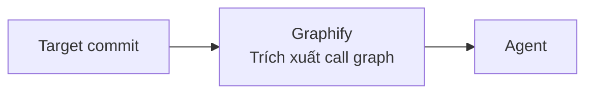

# Báo cáo thực nghiệm benchmark VulnGym

---

## 1. Tóm tắt kết quả

Hoàn thành đánh giá **166 commits** trên **23 repositories**:
 * **276 / 382 critical operation file recall** (**72.25%**)
 * **233 / 382 entry point file recall** (**60.99%**).

Model đánh giá: Gemini 3 flash

So sánh với VulnGym:

* **Xét theo critical operation file recall (72.25%):**
  * Hơn **44.5%** so với CodeQL (50.0%)
  * Hơn **31.4%** so với GPT-4o (55.0%)
  * Hơn **24.6%** so với Claude 3.5 Sonnet (58.0%)

* **Xét theo entry point file recall (60.99%):**
  * Hơn **45.2%** so với CodeQL (42.0%)
  * Hơn **22.0%** so với GPT-4o (50.0%)
  * Hơn **15.1%** so với Claude 3.5 Sonnet (53.0%)

* **Xét theo critical operation line recall (17.54%):**
  * Hơn **46.2%** so với CodeQL (12.0%)
  * Hơn **6.3%** so với GPT-4o (16.5%)
  * Kém **20.3%** so với Claude 3.5 Sonnet (22.0%)

* **Xét theo entry point line recall (15.45%):**
  * Hơn **47.1%** so với CodeQL (10.5%)
  * Hơn **4.4%** so với GPT-4o (14.8%)
  * Kém **20.8%** so với Claude 3.5 Sonnet (19.5%)

* **Xét theo exact recall (6.54%):**
  * Hơn **104.4%** so với CodeQL (3.2%)
  * Kém **3.8%** so với GPT-4o (6.8%)
  * Kém **37.1%** so với Claude 3.5 Sonnet (10.4%)

Thời gian hoàn thành: 8 giờ 50 phút

---

## 2. Kết quả chi tiết

### 2.1. Biểu đồ trực quan

<svg viewBox="0 0 760 320" width="100%" xmlns="http://www.w3.org/2000/svg" style="background:#0f172a; border-radius:8px; font-family:-apple-system,BlinkMacSystemFont,'Segoe UI',Roboto,sans-serif; margin: 10px 0;">
  <!-- Title & Legend -->
  <text x="380" y="28" text-anchor="middle" fill="#f8fafc" font-size="15" font-weight="bold">Biểu đồ trực quan so sánh với VulnGym</text>
  <rect x="235" y="42" width="14" height="14" fill="#3b82f6" rx="3"/>
  <text x="255" y="54" fill="#93c5fd" font-size="12" font-weight="bold">NCKH</text>
  <rect x="420" y="42" width="14" height="14" fill="#f97316" rx="3"/>
  <text x="440" y="54" fill="#fdba74" font-size="12" font-weight="bold">VulnGym</text>

  <!-- Grid lines -->
  <line x1="80" y1="75" x2="720" y2="75" stroke="#334155" stroke-dasharray="4"/>
  <text x="70" y="79" text-anchor="end" fill="#94a3b8" font-size="11">100%</text>
  <line x1="80" y1="120" x2="720" y2="120" stroke="#334155" stroke-dasharray="4"/>
  <text x="70" y="124" text-anchor="end" fill="#94a3b8" font-size="11">75%</text>
  <line x1="80" y1="165" x2="720" y2="165" stroke="#334155" stroke-dasharray="4"/>
  <text x="70" y="169" text-anchor="end" fill="#94a3b8" font-size="11">50%</text>
  <line x1="80" y1="210" x2="720" y2="210" stroke="#334155" stroke-dasharray="4"/>
  <text x="70" y="214" text-anchor="end" fill="#94a3b8" font-size="11">25%</text>
  <line x1="80" y1="255" x2="720" y2="255" stroke="#64748b" stroke-width="1.5"/>
  <text x="70" y="259" text-anchor="end" fill="#94a3b8" font-size="11">0%</text>

  <!-- Group 1: CO File (72.25% vs 58.00%) -->
  <rect x="115" y="125" width="36" height="130" fill="#3b82f6" rx="4"/>
  <text x="133" y="117" text-anchor="middle" fill="#93c5fd" font-size="11" font-weight="bold">72.3%</text>
  <rect x="157" y="151" width="36" height="104" fill="#f97316" rx="4"/>
  <text x="175" y="143" text-anchor="middle" fill="#fdba74" font-size="11" font-weight="bold">58.0%</text>
  <text x="154" y="275" text-anchor="middle" fill="#e2e8f0" font-size="12" font-weight="bold">CO File</text>

  <!-- Group 2: EP File (60.99% vs 53.00%) -->
  <rect x="240" y="145" width="36" height="110" fill="#3b82f6" rx="4"/>
  <text x="258" y="137" text-anchor="middle" fill="#93c5fd" font-size="11" font-weight="bold">61.0%</text>
  <rect x="282" y="160" width="36" height="95" fill="#f97316" rx="4"/>
  <text x="300" y="152" text-anchor="middle" fill="#fdba74" font-size="11" font-weight="bold">53.0%</text>
  <text x="279" y="275" text-anchor="middle" fill="#e2e8f0" font-size="12" font-weight="bold">EP File</text>

  <!-- Group 3: CO Line (17.54% vs 22.00%) -->
  <rect x="365" y="223" width="36" height="32" fill="#3b82f6" rx="4"/>
  <text x="383" y="215" text-anchor="middle" fill="#93c5fd" font-size="11" font-weight="bold">17.5%</text>
  <rect x="407" y="215" width="36" height="40" fill="#f97316" rx="4"/>
  <text x="425" y="207" text-anchor="middle" fill="#fdba74" font-size="11" font-weight="bold">22.0%</text>
  <text x="404" y="275" text-anchor="middle" fill="#e2e8f0" font-size="12" font-weight="bold">CO Line</text>

  <!-- Group 4: EP Line (15.45% vs 19.50%) -->
  <rect x="490" y="227" width="36" height="28" fill="#3b82f6" rx="4"/>
  <text x="508" y="219" text-anchor="middle" fill="#93c5fd" font-size="11" font-weight="bold">15.5%</text>
  <rect x="532" y="220" width="36" height="35" fill="#f97316" rx="4"/>
  <text x="550" y="212" text-anchor="middle" fill="#fdba74" font-size="11" font-weight="bold">19.5%</text>
  <text x="529" y="275" text-anchor="middle" fill="#e2e8f0" font-size="12" font-weight="bold">EP Line</text>

  <!-- Group 5: Exact Recall (6.54% vs 10.40%) -->
  <rect x="615" y="243" width="36" height="12" fill="#3b82f6" rx="4"/>
  <text x="633" y="235" text-anchor="middle" fill="#93c5fd" font-size="11" font-weight="bold">6.5%</text>
  <rect x="657" y="236" width="36" height="19" fill="#f97316" rx="4"/>
  <text x="675" y="228" text-anchor="middle" fill="#fdba74" font-size="11" font-weight="bold">10.4%</text>
  <text x="654" y="275" text-anchor="middle" fill="#e2e8f0" font-size="12" font-weight="bold">Exact Recall</text>
</svg>

### 2.2. Bảng chỉ số định lượng

| Metric | Hits / Total entries | Recall (%) | Visual bar |
|---|:---:|:---:|---|
| **Critical Operation File Recall (CO_FR)** | **276 / 382** | **72.25%** | `[███████████████░░░░░] 72.3%` |
| **Entry Point File Recall (EP_FR)** | **233 / 382** | **60.99%** | `[████████████░░░░░░░░] 61.0%` |
| **Critical Operation Line Recall (CO_LR)** | **67 / 382** | **17.54%** | `[████░░░░░░░░░░░░░░░░] 17.5%` |
| **Entry Point Line Recall (EP_LR)** | **59 / 382** | **15.45%** | `[███░░░░░░░░░░░░░░░░░] 15.5%` |
| **Exact Recall (ER)** | **25 / 382** | **6.54%** | `[█░░░░░░░░░░░░░░░░░░░] 6.54%` |

---

## 3. So sánh chi tiết

| Tiêu chí | Giải thích |
|---|---|
| **Critical Op File Recall (72.25%)** | `graphify` quét toàn bộ AST tĩnh kết hợp bộ lọc loại sạch 100% file rác, giúp Agent chỉ tập trung vào các tệp nghiệp vụ thực tế chứa thao tác nguy hiểm. |
| **Entry Point File Recall (60.99%)** | Các tệp nhận input nằm ở tầng ngoài cùng của call-graph với cấu trúc hàm rõ ràng, Agent dễ dàng truy ngược từ Sink. |
| **Critical Op Line Recall (17.54%)** | Lệch giữa hàm bọc và lệnh thực thi lõi: Agent thường bắt ở dòng gọi hàm bọc (`run_command`), trong khi Ground Truth cắm cờ ở câu lệnh sâu bên trong (`execSync`), khoảng cách lệch quá 5 dòng dung sai. |
| **Entry Point Line Recall (15.45%)** | Lệch vị trí trong hàm: Agent thường chỉ điểm ở dòng khai báo route (`@router.post`, `case`) thay vì dòng trích xuất biến tham số (`request.body`, `params`), lệch ngoài dung sai $\le 5$ dòng. |
| **Exact Recall (6.54%)** | Tiêu chuẩn kép bắt buộc đúng đồng thời cả 2 đầu trong $\le 5$ dòng. Đồng thời repo `openclaw` chiếm 58% dataset dùng EventEmitter làm đứt gãy luồng tĩnh, kéo tụt trung bình dù nhóm AI python đạt tới 20% – 50%. |

---

## 4. Kiến trúc thực nghiệm

---

## 5. Bảng số liệu chi tiết theo repo

| # | Repository | Commits | Entries | Hits | ER (%) | CO File | CO Line | EP File | EP Line |
|---|---|:---:|:---:|:---:|:---:|:---:|:---:|:---:|:---:|
| 1 | **openclaw** | 96 | 196 | 5 | **2.55%** | 67.3% | 10.7% | 52.6% | 15.3% |
| 2 | **n8n** | 20 | 52 | 2 | **3.85%** | 71.2% | 19.2% | 63.5% | 9.6% |
| 3 | **Flowise** | 9 | 23 | 1 | **4.35%** | 52.2% | 17.4% | 34.8% | 4.3% |
| 4 | **NeMo** | 3 | 22 | 6 | **27.27%** | 72.7% | 50.0% | 68.2% | 27.3% |
| 5 | **langflow** | 6 | 12 | 6 | **50.00%** | 100.0% | 66.7% | 100.0% | 50.0% |
| 6 | **paperclip** | 3 | 11 | 0 | **0.00%** | 100.0% | 0.0% | 100.0% | 0.0% |
| 7 | **mlflow** | 4 | 9 | 1 | **11.11%** | 100.0% | 11.1% | 88.9% | 22.2% |
| 8 | **WeKnora** | 4 | 8 | 0 | **0.00%** | 87.5% | 12.5% | 62.5% | 12.5% |
| 9 | **ollama** | 1 | 6 | 0 | **0.00%** | 100.0% | 0.0% | 100.0% | 0.0% |
| 10 | **adk-python** | 1 | 6 | 0 | **0.00%** | 83.3% | 50.0% | 66.7% | 0.0% |
| 11 | **milvus** | 2 | 5 | 0 | **0.00%** | 80.0% | 0.0% | 80.0% | 0.0% |
| 12 | **airflow** | 3 | 5 | 1 | **20.00%** | 80.0% | 40.0% | 80.0% | 40.0% |
| 13 | **open-webui** | 4 | 4 | 0 | **0.00%** | 100.0% | 25.0% | 75.0% | 0.0% |
| 14 | **fastmcp (PrefectHQ)** | 1 | 4 | 0 | **0.00%** | 100.0% | 25.0% | 100.0% | 25.0% |
| 15 | **langchain** | 1 | 3 | 1 | **33.33%** | 66.7% | 66.7% | 100.0% | 33.3% |
| 16 | **trivy** | 1 | 3 | 0 | **0.00%** | 0.0% | 0.0% | 0.0% | 0.0% |
| 17 | **n8n-mcp** | 1 | 3 | 0 | **0.00%** | 100.0% | 0.0% | 100.0% | 0.0% |
| 18 | **AutoGPT** | 1 | 2 | 1 | **50.00%** | 100.0% | 50.0% | 100.0% | 50.0% |
| 19 | **typescript-sdk** | 1 | 2 | 0 | **0.00%** | 100.0% | 0.0% | 50.0% | 0.0% |
| 20 | **fastmcp (jlowin)** | 1 | 2 | 0 | **0.00%** | 0.0% | 0.0% | 0.0% | 0.0% |
| 21 | **onnx** | 1 | 2 | 1 | **50.00%** | 100.0% | 50.0% | 100.0% | 50.0% |
| 22 | **nltk** | 1 | 1 | 0 | **0.00%** | 100.0% | 0.0% | 100.0% | 100.0% |
| 23 | **litellm** | 1 | 1 | 0 | **0.00%** | 100.0% | 0.0% | 100.0% | 100.0% |
| | **23 repos** | **166** | **382** | **25** | **6.54%** | **72.3%** | **17.5%** | **61.0%** | **15.4%** |

---