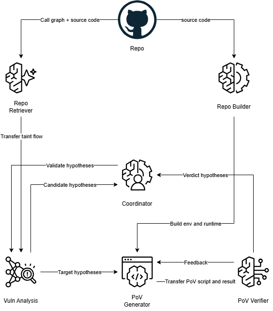

# Architecture Diagram

  

# Mô tả chi tiết

---

## 1. Repo Retriever

- **Trách nhiệm:** Khảo sát toàn diện kho mã nguồn thông qua Graphify và các công cụ phân tích cấu trúc để xây dựng đồ thị gọi hàm. Tự động truy vết và giải mã các hàm ẩn do con trỏ hàm, macro định nghĩa hoặc liên kết động gây ra nhằm hàn gắn các mắt xích đứt đoạn. Xử lý triệt để việc khử trùng lặp và chặn chu trình đệ quy lặp vô tận, bóc tách các chuỗi Taint Flow hoàn chỉnh và chuyển trực tiếp sang Vuln Analysis.

- **Input:** Mã nguồn dự án cùng đồ thị gọi hàm từ Repo.

- **Output:** Taint Flow hoàn chỉnh - Transfer taint flow gửi đến Vuln Analysis.

- **Model:** Model nhanh.

- **Tools:** Graphify, Symbol analyzer, Traversal scripts.

---

## 2. Repo Builder

- **Trách nhiệm:** Phân tích cấu hình dự án để thiết lập môi trường Docker khép kín, cài đặt các gói phụ thuộc theo từng ngôn ngữ, kích hoạt các công cụ giám sát runtime phù hợp như Sanitizer, Race detector, Debugger hoặc Runtime tracer và tự động xử lý lỗi biên dịch để ứng dụng thực thi được, sau đó bàn giao môi trường hoàn chỉnh cho PoV Generator.

- **Input:** Mã nguồn dự án và tập tin hướng dẫn cấu hình từ Repo.

- **Output:** Môi trường thực thi kèm công cụ giám sát runtime - Build env and runtime bàn giao cho PoV Generator.

- **Model:** Model trung bình.

- **Tools:** Docker execution, Shell script, Build harness.

---

## 3. Coordinator

- **Trách nhiệm:** Bộ não điều phối cấp cao và quản lý mô hình hiểm họa. Tiếp nhận các giả thuyết ứng viên từ Vuln Analysis để tranh biện, phản biện và xác thực tính hợp lý theo ranh giới tin cậy. Tiếp nhận phán quyết cuối cùng từ PoV Verifier để chốt báo cáo lỗ hổng hoặc điều hướng chiến lược kiểm thử lại khi PoV thất bại.

- **Input:** Candidate hypotheses từ Vuln Analysis, Verdict hypotheses từ PoV Verifier.

- **Output:** Validate hypotheses phản biện lại Vuln Analysis, Báo cáo lỗ hổng thẩm định cuối cùng.

- **Model:** Model mạnh.

- **Tools:** Quản lý trạng thái, Context summarizer.

---

## 4. Vuln Analysis

- **Trách nhiệm:** Bộ não phân tích bảo mật ngữ nghĩa chuyên sâu. Đọc sâu mã nguồn các hàm dọc theo chuỗi Taint Flow do Repo Retriever cung cấp, đối chiếu điểm vào dữ liệu và điểm thao tác nhạy cảm, phân tích ngữ nghĩa để xác định nguyên nhân gốc rễ và phân loại CWE. Đề xuất giả thuyết ứng viên lên Coordinator để thẩm định hai chiều, sau đó bàn giao đặc tả mục tiêu khai thác kèm điều kiện kích hoạt sang PoV Generator.

- **Input:** Taint Flow từ Repo Retriever, Validate hypotheses từ Coordinator, mã nguồn chi tiết trong repo.

- **Output:** Candidate hypotheses đề xuất lên Coordinator, Target hypotheses chuyển sang PoV Generator.

- **Model:** Model mạnh.

- **Tools:** Trích xuất mã nguồn, Code viewer, Semantic parser.

---

## 5. PoV Generator

- **Trách nhiệm:** Tác tử thực thi kịch bản kiểm thử. Tiếp nhận đặc tả mục tiêu từ Vuln Analysis và môi trường runtime từ Repo Builder để thiết kế dữ liệu đầu vào cùng kịch bản khai thác. Trực tiếp thực thi kịch bản trong môi trường Docker để thu thập kết quả và log chạy thực tế, chuyển toàn bộ sang PoV Verifier, đồng thời tinh chỉnh kịch bản dựa trên phản hồi kỹ thuật từ Verifier.

- **Input:** Target hypotheses từ Vuln Analysis, Build env and runtime từ Repo Builder, Feedback từ PoV Verifier.

- **Output:** Kịch bản kiểm thử kèm kết quả thực thi thực tế - Transfer PoV script and result gửi sang PoV Verifier.

- **Model:** Model mạnh.

- **Tools:** Trình sinh mã, Runtime executor, Python script.

---

## 6. PoV Verifier

- **Trách nhiệm:** Thẩm định viên độc lập đóng vai trò phê bình và giám sát. Không trực tiếp chạy lại mã mà phân tích kịch bản kiểm thử đối chiếu với log thực thi và mã lỗi runtime từ PoV Generator để xác minh xem lỗi kích hoạt có thực sự hợp lệ hay chỉ là crash vô hại. Gửi phản hồi kỹ thuật để PoV Generator tinh chỉnh kịch bản hoặc gửi phán quyết thẩm định cuối cùng lên Coordinator.

- **Input:** PoV script and result từ PoV Generator.

- **Output:** Feedback kỹ thuật gửi cho PoV Generator, Verdict hypotheses gửi lên Coordinator.

- **Model:** Model nhanh hoặc trung bình.

- **Tools:** Log parser, Runtime oracle analyzer.

---

# Đóng góp

---

## 1. Đề xuất kiến trúc đa tác tử phân tầng hoàn chỉnh từ phân tích mã nguồn đến thực thi kiểm chứng

Xây dựng hệ thống phối hợp đa tác tử gồm sáu thành phần chuyên biệt: Repo Retriever, Repo Builder, Coordinator, Vuln Analysis, PoV Generator và PoV Verifier. Kiến trúc phân tách độc lập giữa làn phân tích tĩnh và làn đóng gói môi trường runtime, khắc phục triệt để hiện tượng quá tải ngữ cảnh và cạn kiệt ngân sách tính toán đã được chỉ ra trong các nghiên cứu SEC-bench và IEEE Access.

## 2. Thiết kế lược đồ bằng chứng thống nhất cho toàn bộ chu trình kiểm thử

Chuẩn hóa lược đồ dữ liệu trung gian có cấu trúc xuyên suốt giữa các tác tử, bao gồm phân loại CWE, vị trí tệp tin và dòng mã nguồn, entry point, critical operation, chuỗi vết source-to-sink trace, precondition kích hoạt, kịch bản PoV và kết quả thực thi runtime. Việc chuẩn hóa này loại bỏ triệt để hiện tượng ảo giác, tạo cầu nối dữ liệu chặt chẽ và nhất quán giữa các khâu suy luận.

## 3. Cơ chế sàng lọc và xếp hạng ứng viên dựa trên khả năng tiếp cận và bằng chứng thực tế

Thiết lập quy trình ưu tiên và sàng lọc giả thuyết dựa trên bốn trụ cột chính:
- Tính khả thi của đường dẫn thực thi - Reachability analysis qua đồ thị gọi hàm.
- Bằng chứng phân tích cú pháp và ngữ nghĩa từ Repo Retriever.
- Mức độ nghiêm trọng của phân loại lỗi - Severity scoring.
- Khả năng kiểm chứng thực tế trong môi trường sandbox để loại bỏ sớm các cảnh báo giả.

## 4. Kiểm soát bùng nổ đường đi và chống trôi ngữ cảnh bằng lát cắt Taint Flow

Ứng dụng đồ thị Graphify kết hợp cơ chế khử trùng lặp và chặn chu trình đệ quy lặp vô tận, tự động giải mã con trỏ hàm và liên kết ẩn. Đóng gói mã nguồn thành các lát cắt Taint Flow độc lập gửi trực tiếp cho Vuln Analysis, giúp tác tử phân tích dứt điểm từng lát cắt và làm mới bộ nhớ đệm, triệt tiêu hoàn toàn hiện tượng mất trí nhớ khi xử lý kho mã nguồn quy mô lớn.

## 5. Quy trình đánh giá thực nghiệm toàn diện và kiểm soát rò rỉ dữ liệu

Định hình khung đánh giá thực nghiệm đa chiều bao gồm độ chính xác phát hiện, năng lực định vị dòng lỗi, độ bao phủ chuỗi vết, tỷ lệ thực thi PoV thành công, tỷ lệ cảnh báo giả, thời gian thực thi và chi phí token. Tích hợp nghiên cứu bóc tách từng thành phần - Ablation study và quy trình kiểm định rò rỉ dữ liệu huấn luyện - Data leakage nhằm bảo đảm tính khách quan và độ tin cậy khoa học.